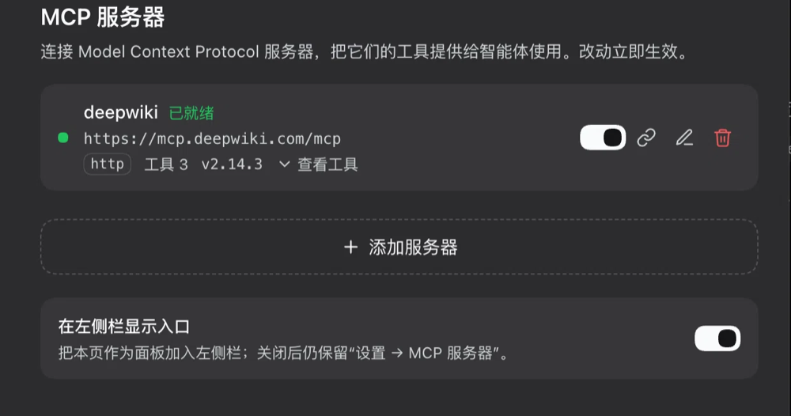
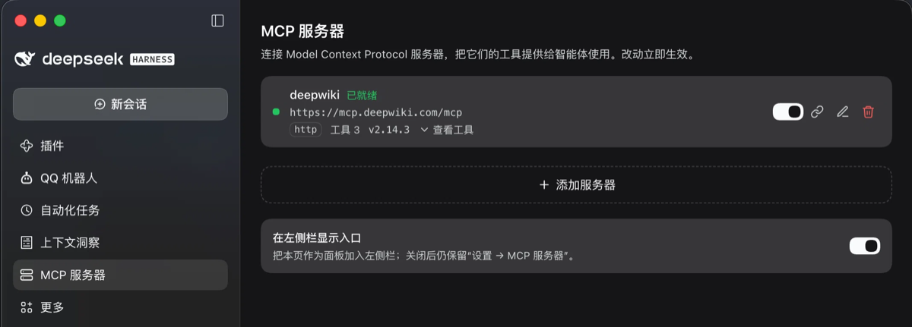
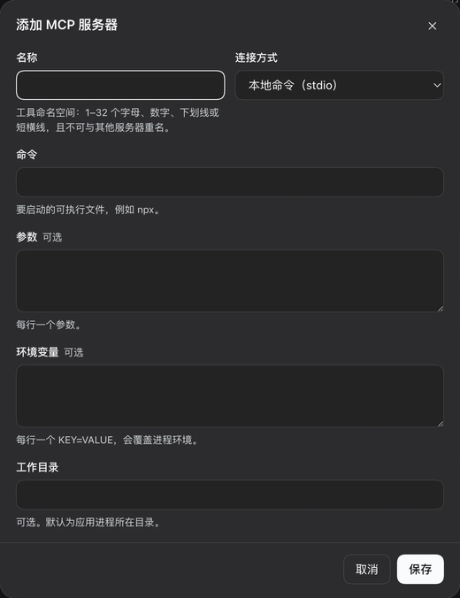
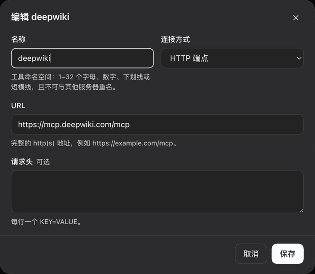

# dsh-mcp-manager


[](https://github.com/kuhufu/dsh-mcp-manager/actions/workflows/ci.yml)
[](LICENSE)

**MCP server management for [DeepSeek Harness](https://github.com/deepseek-ai/deepseek-harness).**
Add, edit, enable, disable and reconnect **Model Context Protocol** servers from the Web UI. Their
tools appear in the agent as native `mcp__<server>__<tool>` tools — no hand-editing
`cordis.patch.yml`, no Harness restart.

[中文](README.md) | English

## Features

- **One page, two surfaces.** **Settings → MCP servers** always exists; an optional left-rail
  entry with this plugin's own icon opens the same page as a standalone panel. The switch at the
  bottom of the page controls it (default: shown).
- **Full lifecycle.** Add, edit, enable/disable, reconnect and delete. Saving connects
  immediately; disabling kills the child process and removes its tools; reconnecting re-handshakes
  and swaps the whole tool set atomically.
- **stdio and Streamable HTTP.** stdio supports command, arguments, environment variables and a
  working directory; HTTP supports a URL and request headers.
- **Live status and diagnostics.** Connected / connecting / failed (with the server's error text),
  tool count, server version, instructions, an expandable tool list, and the last 50 connection,
  refresh and call outcomes.
- **Per-session `/mcp` switches.** Type `/mcp` in the composer for a panel that hides or shows
  servers for the current session only; `/mcp on|off|list|reset` are the command forms. Overrides
  persist per session and never change the saved configuration. The same data is available as an
  **MCP** tab beside Chat and Trajectory.
- **Default injection.** Turn off *Inject into every session by default* for a tool-heavy server:
  it stays disconnected until a session enables it from `/mcp`. `dsh-mcp-client` entries have the
  same switch.
- **Coexists with existing `dsh-mcp-client` entries.** Foreign rows show their entry id, transport
  and live tool count, and can be enabled or disabled in place. **Migrate here** disables the
  source first and waits for its tools to be released before copying the config and connecting, so
  two connections never compete for the same tool names.
- **Configuration management.** Search, status filtering, duplicate as a uniquely named draft,
  JSON import/export, damaged-storage recovery, per-tool switches and dynamic tool-list refresh.
- **No dependencies.** A small self-contained MCP client (stdio JSON-RPC + Streamable HTTP),
  atomic JSON persistence and exact Fetch routes. No build step, no runtime dependencies.

## Screenshots

Settings → MCP servers: a live server's status, endpoint, tool count and version, the dashed add
row, and the sidebar preference that controls the second surface.



The same page opened from the left rail — the rail icon is this plugin's own, and both surfaces
render identically.



Adding a server takes either a command line (stdio) or a URL (HTTP). Both dialogs validate the tool
namespace so two servers can never collide on `mcp__<name>__<tool>`.

| Add a server (stdio) | Edit a server (HTTP) |
| --- | --- |
|  |  |

## Install

Requires a Harness build that ships the Cordis Fetch-route and slot APIs used here (developed and
tested against `0.2.1-rc.5`). Running from a checkout or developing also requires Node 22+.

### Web UI (desktop app or `dsh web`)

1. Open **Settings → Plugins → Add plugin**.
2. Enter `@kuhufu/dsh-mcp-manager` and click **Install**.
3. Confirm the bundle is **enabled** in the plugin list. Installation and enablement are separate;
   an installed bundle that is switched off loads nothing.

For a Git checkout, use the CLI below instead: it installs the directory as a link, so local edits
apply on the next reload.

### `dsh` CLI

```sh
# install into a CLI profile (web, tui, or your own profile name)
dsh plugin --profile web add @kuhufu/dsh-mcp-manager

# update to the latest published version
dsh plugin --profile web update @kuhufu/dsh-mcp-manager@latest

# uninstall
dsh plugin --profile web remove @kuhufu/dsh-mcp-manager
```

Start the UI (`dsh web`) afterwards, and enable the bundle in **Settings → Plugins** if it is not
enabled yet. A checkout installs the same way:

```sh
git clone https://github.com/kuhufu/dsh-mcp-manager.git
dsh plugin --profile web add ./dsh-mcp-manager   # relative paths resolve from your shell's cwd
```

### Desktop app profile

The desktop app owns the `desktop` profile. Open the app once so the profile exists, **fully quit**
it, then run:

```sh
dsh plugin --profile desktop add @kuhufu/dsh-mcp-manager
```

and start the app again. Running the plugin command while the app is up can race its profile lock.

> The npm name `dsh-mcp-manager` belongs to an unrelated project, so this plugin publishes under
> the `@kuhufu` scope. Until it is published there, install from a Git checkout as shown above.

## Usage

### Adding and managing

| Action | Effect |
| --- | --- |
| Add server | Pick a transport, fill in the fields and save. Saving connects immediately. |
| Enable / disable | Disabling ends the child process and removes its tools; the configuration stays. |
| Reconnect | New handshake and a fresh tool generation (after env changes or a server upgrade). |
| Edit | Saving restarts the connection when connection-relevant fields change; renaming changes the tool namespace. |
| Delete | Disconnects, unregisters the tools and removes the record (inline confirmation). |
| Show in the sidebar | Installs or removes the left-rail entry; the Settings page is unaffected. |
| Foreign entry switch | Enables or disables that `dsh-mcp-client` row, the same as **Settings → Plugins**. The switch is locked when a managed record already owns the name. |

### Tool naming

Tools are registered as `mcp__<serverName>__<rawToolName>`, with every character outside
`[A-Za-z0-9_-]` replaced by `_` (so `mix.content` becomes `mcp__mix_content`). An MCP `isError`
result fails the call with the server's text. Reconnecting or restarting swaps the whole tool set
atomically. A cross-server name collision (for example server `a__b` + tool `c` versus server `a` +
tool `b__c`) fails that server's registration with an error state rather than renaming silently.

### Transports

- **stdio**: `command` + `args` + `env` (optional `cwd`), e.g. `command: npx`,
  `args: -y @modelcontextprotocol/server-filesystem /tmp`.
- **HTTP** (Streamable HTTP): `url` and optional `headers`, e.g. `Authorization: Bearer …`.

Connection options:

- Handshake timeout defaults to 30 s; tool-call timeout defaults to 60 s. Both are configurable.
- Automatic reconnect is off by default, retries 0–10 times, and backs off exponentially up to 30 s.
- Expanding a server shows its public tool names, per-tool switches, and the last 50 activity
  entries (tool arguments and result bodies are excluded).

### Per-session `/mcp`

- Type `/mcp` in the composer to open the current session's panel, or use the **MCP** tab next to
  Chat and Trajectory.
- `/mcp on <server>`, `/mcp off <server>`, `/mcp list` and `/mcp reset` are the command forms.
- Overrides live in the Session's own document and never modify global configuration. A session
  that shows a globally disabled server connects it on demand without enabling it for everyone.
- Hiding a `dsh-mcp-client` entry applies an agent-scoped `ctx.tools.restrict({ deny: [...] })`
  mask, so its globally registered tools disappear for that session only.

### Foreign entries and migration

Servers already configured as separate `@deepseek-ai/dsh-mcp-client` rows appear as read-only rows:

- **Enable/disable** writes the profile's enablement state without touching the row's config.
- **Migrate here** disables the source row, waits for its tools and child process to be released,
  then copies the config into a managed record and connects. If a managed record with the same name
  exists, it is replaced in place with its id kept — this also repairs a row stuck in the collision
  error.
- Migration copies environment variables and headers as plain text; `!!js process.env.X` becomes
  the resolved value.

### Import, export and duplicate

Expand the transfer section above the final **Show in the sidebar** row:

- Accepts a server array, a `{ "version": 1, "servers": [...] }` export document, or the common
  `{ "mcpServers": { "name": { "command": "…" } } }` shape.
- 1–200 records per batch; the whole batch is validated before any write. Duplicate names reject
  the batch.
- Imported servers are always disabled. Fill in missing credentials, then enable them manually.
- Export omits environment variables and headers by default; check the option to include those
  plain-text values. Command arguments and URLs are always retained and may themselves contain
  credentials.
- Duplicate opens an editable draft with a unique name and disabled state; a record is created only
  after saving.

## Data and security

| File (under `$DSH_HOME/storages/`, `$DSH_HOME` defaults to `~/.dsh`) | Contents |
| --- | --- |
| `mcp-manager.json` | Server records and the `ui.railEntry` preference |
| `mcp-manager-sessions.json` | Per-session `/mcp` overrides |
| `mcp-manager-external.json` | Default-injection flags for foreign entries (only disabled entries are recorded) |
| `mcp-manager.json.bak` | The previous valid document |

- Writes are serialized and atomic (temporary file + `rename`), memory is committed only after
  persistence succeeds, and files are created with `0600` permissions.
- A corrupt, unreadable or unsupported-version document enters read-only recovery instead of being
  overwritten. Backup restore and reset archive the original bytes as
  `.recovery-<time>-<uuid>` first. Legacy documents without `version` or `ui` remain readable and
  migrate on the next write.
- Invalid or duplicate individual records are skipped with warnings; valid servers remain usable.
  The original document is archived before the next write.
- Environment variables and headers are stored as **plain text**. MCP servers are ordinary
  processes started as your user; this plugin adds no sandbox. Only add servers you trust.

## Architecture

| Part | Files | Role |
| --- | --- | --- |
| Host | `index.js` + `host/` | Records, MCP connections, tool registration, session visibility, foreign-entry migration and Fetch routes |
| Client | `client.js` | One React page registered into `settings.section`; optional `sidebar.panellist` + `main` entry; the `conversation.view` MCP tab and composer overlay |

Host modules:

| File | Role |
| --- | --- |
| `host/manager.js` | Serialized configuration operations and ownership of the store, runtime and session/external state |
| `host/runtime.js` | Connection lifetimes, retries, tool definitions and activity |
| `host/agents.js` | Per-agent tool registration and `/mcp` visibility |
| `host/session-state.js` | Persisted per-session overrides |
| `host/external.js` / `external-defaults.js` | `dsh-mcp-client` enablement, migration and default injection |
| `host/profile-patch.js` / `patch-repair.js` | Duplicate-declaration repair in profile/home patches |
| `host/mcp.js` | Dependency-free MCP client (stdio + Streamable HTTP) and tool bridge |
| `host/store.js` | Validation, atomic persistence and recovery |
| `host/routes.js` | Fetch routes and response shaping |

All page traffic uses exact `POST` routes on the Harness Fetch bridge (relative
`api/mcp-manager.*`, authenticated by the browser session, `cache-control: no-store`):

| Route | Purpose |
| --- | --- |
| `list` | Managed servers + read-only `external` rows + `ui` |
| `save` / `remove` / `toggle` / `reconnect` | Server mutations and connection control |
| `takeover` | Disable a `dsh-mcp-client` entry and re-create it as a managed record |
| `toggle-external` | Enable or disable a `dsh-mcp-client` entry |
| `external-default` | Default-injection preference for a foreign entry |
| `ui` | The `railEntry` preference |
| `session` / `session-set` | Session visibility and reset |
| `import` / `export` | Batch import and credential-optional export |
| `recover` | Archive the original and restore a backup or reset |
| `tool` | Enable or disable a raw tool name |
| `repair-patch` | Move duplicate home-patch declarations into the profile patch |

`CONTRACT.md` pins the request/response shapes, validation rules and tool-bridge contract.

## Development

Plain ESM, no build step, no runtime dependencies, Node 22+. Node tests use built-ins only; the
browser suite has separate development-only dependencies.

```sh
npm run check           # syntax-check all sources, scripts and tests
npm test                # four smoke suites + Node regression/client tests
npm run test:regression # only the node:test regression and client tests
npm run test:browser    # after preparing the environment in test/BROWSER.md
```

- Smoke suites: `mcp` 29 checks, `external` 93, `takeover-race` 8, `patch-repair` 23.
- Node: 31 `regression` + 18 `client` tests, 49 in total, covering dual-entry sync, stale poll
  responses, cancellation, failed writes, recovery, dynamic tools and page races.
- The browser suite runs a real React 18 page against real Host routes and a local fake MCP server.
  It covers add/edit/duplicate/delete, connection options, tool switches, import/export,
  search/filter, the sidebar preference, dialog focus, and horizontal overflow at 320–1440 px.
  See [test/BROWSER.md](test/BROWSER.md).
- CI runs `check` and `test` on Ubuntu/macOS × Node 22/24, plus a separate browser job.

## Troubleshooting

**`Connection failed — tool "mcp__X__y" is already registered`**

Another MCP connection already owns that tool name, usually a `@deepseek-ai/dsh-mcp-client` row
with the same `serverName`. Do not add a second copy by hand: open the read-only foreign list and
press **Migrate here** — it disables the source and waits for the old tools to be released. If a
managed record with the same name exists (for example the row stuck in this error), migration
replaces it in place and keeps its id; press **Migrate here** again to repair it. If the conflicting
entry is not in the list, disable it under **Settings → Plugins** first, then reconnect.

**The page is missing after installing**

Installation and enablement are two steps. Enable the bundle in **Settings → Plugins**, then
reload the window.

**A `dsh-mcp-client` switch does nothing / the row stays enabled**

The profile patch declares that entry twice: a `disabled: true` override appears *before* a later
`insert` of the same id. Plugin Manager rewrites the override in place, while the later insert keeps
winning. The plugin repairs that shape itself: it drops the stale `id`/`disabled`-only rows, keeps
the declaration carrying the configuration, and appends a final `disabled` row so the last
declaration wins. It backs the patch up as `cordis.patch.yml.bak-<timestamp>` and only touches that
exact shape; anything else keeps the `overridden` failure.

**Startup fails with `patches ... must be a top-level YAML array`**

`cordis.patch.yml` must begin with a top-level YAML array (keep `[]` even when there are only
comments). `repair-patch` validates this before writing; if an external tool already damaged the
file, restore the `.bak-*` backup beside it or add `[]` and start again.

**The Settings navigation icon is a gear**

The Harness shell maps navigation icons by section id, so a third-party Settings section always
gets the fallback gear. This plugin's own icon is the left-rail entry, controlled by the switch at
the bottom of the page.

## Limitations

- MCP image/audio results are not persisted; non-text blocks are surfaced as text diagnostics.
- MCP prompts and resources are not supported (matching the official `dsh-mcp-client` bridge).
- A cross-server tool-name collision fails that server's registration with an error state rather
  than renaming silently.

## License

[MIT](LICENSE)
