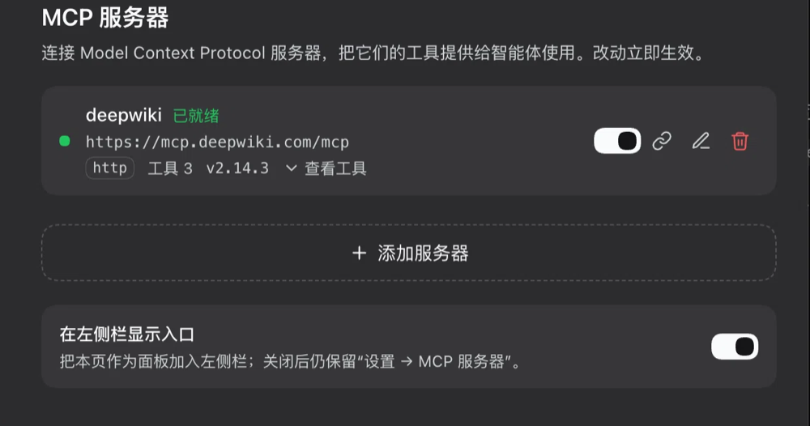
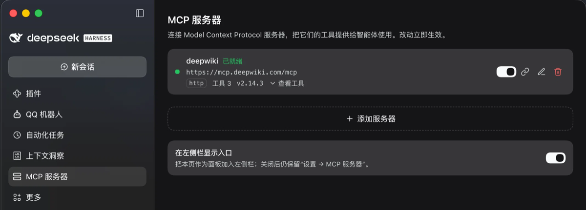
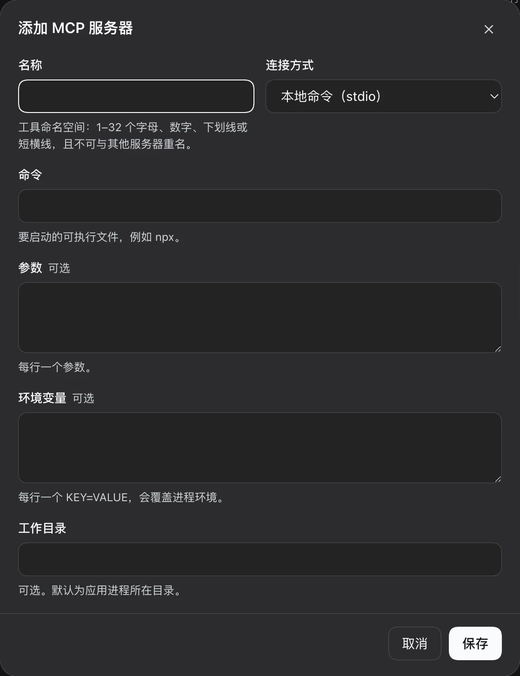
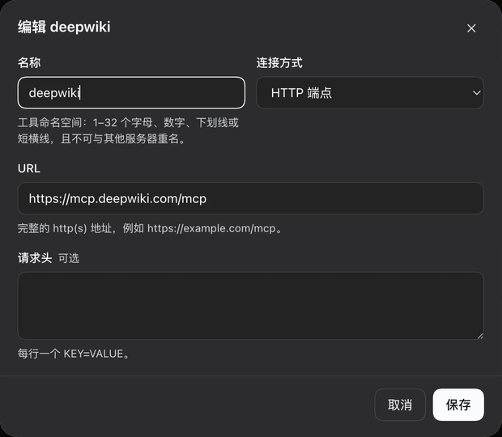

# dsh-mcp-manager


MCP server management for [DeepSeek Harness](https://github.com/deepseek-ai/deepseek-harness):
manage **Model Context Protocol** servers from the Web UI and get their tools as native
`mcp__<server>__<tool>` tools for the agent — no hand-editing of `cordis.patch.yml`, no restart.

[中文](README.zh.md) | English

## Features

- **Two surfaces, one page.** Settings → **MCP servers** always exists; an optional left-rail
  entry with this plugin's own icon opens the same page as a standalone panel. A switch at the
  bottom of the page shows or hides the rail entry (default: shown).
- **Full lifecycle from the UI.** Add, edit, enable/disable, reconnect and delete servers.
  Saving connects immediately; disabling kills the child process and unregisters its tools;
  reconnecting re-handshakes and swaps the tool set atomically.
- **stdio and Streamable HTTP** transports, with environment variables, request headers and
  working directory.
- **Live status**: connected / connecting / failed (with the server's error text), tool count,
  server version, instructions, and the discovered tool list.
- **Foreign entries are visible, not duplicated.** MCP servers already configured as separate
  `@deepseek-ai/dsh-mcp-client` rows appear with their Entry id and live tool count, and can be
  switched on or off from this page without touching their configuration.
  **Migrate here** moves one over: it disables the source row first, then copies the config into
  this page and connects — so two connections never compete for the same tool names.
- **No dependencies.** A small, self-contained MCP client (stdio JSON-RPC + Streamable HTTP),
  atomic JSON persistence, and eight exact Fetch routes. No build step.

## Screenshots

Settings → MCP servers: a live server with its status, endpoint, tool count and version, the
dashed add row, and the sidebar-entry preference that controls the second surface.



The same page opened from the left rail — the rail icon is this plugin's own, and the page
renders identically in both places.



Adding a server takes either a command line (stdio) or a URL; both dialogs validate the tool
namespace so two servers can never collide on `mcp__<name>__<tool>`.

| Add a server (stdio) | Edit a server (HTTP) |
| --- | --- |
|  |  |


## Install

Requires a Harness build that ships the Cordis Fetch-route and slot APIs used here
(developed and tested against `0.2.1-rc.5`).

### Web UI (desktop app or `dsh web`)

1. Open **Settings → Plugins → Add plugin**.
2. Enter `@kuhufu/dsh-mcp-manager` and click **Install**.
3. Confirm the bundle is enabled in the plugin list — installation and enablement are separate,
   so an installed bundle that is switched off loads nothing.

For a Git checkout, use the CLI below instead of the wizard: it installs the directory as a
link, so local edits apply on the next reload.

### `dsh` CLI

```sh
# install into a CLI profile (`web`, `tui`, or your own profile name); works once published
dsh plugin --profile web add @kuhufu/dsh-mcp-manager

# update to the latest published version
dsh plugin --profile web update @kuhufu/dsh-mcp-manager@latest

# uninstall
dsh plugin --profile web remove @kuhufu/dsh-mcp-manager
```

Afterwards start the UI (`dsh web`) and enable the bundle in **Settings → Plugins** if it is not
enabled yet. A checkout installs the same way:

```sh
git clone https://github.com/kuhufu/dsh-mcp-manager.git
dsh plugin --profile web add ./dsh-mcp-manager   # relative paths resolve from your shell's cwd
```

### Desktop app profile

The desktop app owns the `desktop` profile. Open the app once so the profile exists, **fully
quit** it, then run:

```sh
dsh plugin --profile desktop add @kuhufu/dsh-mcp-manager
```

and start the app again. Running the plugin command while the app is up can race its profile
lock.

> The npm name `dsh-mcp-manager` belongs to an unrelated project, so this plugin publishes under
> the `@kuhufu` scope. Until it is published there, install from a Git checkout as shown above.

## Usage

| Action | What happens |
| --- | --- |
| Add server | Pick a transport, fill the fields, save. The connection is opened right away. |
| Enable / disable | Disabling ends the child process and removes the server's tools; the config stays. |
| Reconnect | New handshake and a fresh tool generation (use after changing env vars or upgrading the server). |
| Edit | Saves and restarts that connection; renaming changes the tool namespace. |
| Delete | Disconnects, unregisters the tools, removes the record (inline confirmation). |
| Show in the sidebar | Installs or removes the left-rail entry; the Settings page is unaffected. |
| Switch a `dsh-mcp-client` row | Enables or disables that row — the same effect as Settings → Plugins, without leaving the page. A row whose name is already managed here is marked **Managed here** and its switch is locked, since enabling both would collide on tool names. |

**Tool naming.** Tools are registered as `mcp__<serverName>__<rawToolName>`, with every character
outside `[A-Za-z0-9_-]` replaced by `_` (so `mix.content` becomes `mcp__mix_content`). An MCP
`isError` result fails the call with the server's text. Re-syncing (or restarting) a server swaps
the whole tool set atomically.

**Transports.**

- `stdio`: `command`, `args`, `env`, optional `cwd` — e.g. `command: npx`,
  `args: -y @modelcontextprotocol/server-filesystem /tmp`.
- `http` (Streamable HTTP): `url` and optional `headers` such as `Authorization: Bearer …`.

## Data and security

- Records live in `$DSH_HOME/storages/mcp-manager.json` (`$DSH_HOME` defaults to `~/.dsh`),
  written atomically and validated on load; a corrupt or legacy document degrades to empty
  servers plus the default preferences instead of breaking the page.
- Environment variables and headers are stored there as **plain text**. If a migrated
  `dsh-mcp-client` row used `!!js process.env.X`, the copy holds the resolved value.
- MCP servers are ordinary processes started as your user; this plugin adds no sandbox.
  Only add servers you trust.

## Architecture

| Part | File | Role |
| --- | --- | --- |
| Host | `index.js` + `host/mcp.js`, `host/store.js`, `host/routes.js` | Owns records, MCP connections, tool registration and the Fetch routes. |
| Client | `client.js` | One React page registered into `settings.section`, plus the optional `sidebar.panellist` + `main` pair. |

All page traffic uses exact `POST` routes on the Harness Fetch bridge (relative
`api/mcp-manager.*`, authenticated by the browser session, `cache-control: no-store`):

| Route | Purpose |
| --- | --- |
| `list` | Managed servers + read-only `external` rows + `ui` |
| `save` / `remove` / `toggle` / `reconnect` | Server mutations |
| `takeover` | Disable a `dsh-mcp-client` entry and re-create it as a managed record |
| `toggle-external` | Enable or disable a `dsh-mcp-client` entry |
| `ui` | The `railEntry` preference |

`CONTRACT.md` pins the request/response shapes, validation rules and tool-bridge contract.

## Development

Plain ESM, no build step, no dependencies. Node 22+.

```bash
node --check index.js && node --check client.js
node test/mcp.smoke.mjs        # 29 checks: transports, store, routes, full plugin lifecycle
node test/external.smoke.mjs   # 54 checks: foreign entries, migration, ui preference
node test/takeover-race.smoke.mjs   # 8 checks: the asynchronous tool release during a migration
```

Both suites are framework-free: they drive the real modules over real stdio/HTTP transports
(and a real fake MCP server), and assert that every spawned process is reaped.

## Troubleshooting

**`Connection failed — tool "mcp__X__y" is already registered`**
Another MCP connection already owns that tool name, usually a `@deepseek-ai/dsh-mcp-client` row
with the same `serverName`. Do not add a second copy by hand: open the read-only
"Configured as dsh-mcp-client entries" list and press **Migrate here**. It disables the source
row first, waits for its tools to be released, and only then connects — so the two connections
never compete. Migrating onto a name this page already manages replaces that record in place
(the id is kept), which is the way to repair a row that is stuck in this error state. If the
conflicting server is not in the list, find and disable its entry under Settings → Plugins
first, then reconnect this row.

**The page is missing after installing** — install and enable are two steps. Enable the bundle in
Settings → Plugins, then reload the window.

**A `dsh-mcp-client` switch does nothing / the row stays enabled** — the row is declared more than
once in the profile patch: a `disabled: true` override sitting *before* a later `insert` of the same
id is updated in place by the Plugin Manager, while the later insert keeps winning. The plugin
repairs that shape itself: it drops the stale override-only rows, keeps the declaration that carries
the configuration, appends a final `disabled` row so the last declaration wins, and leaves a
`cordis.patch.yml.bak-<timestamp>` backup beside the patch. Other duplicate shapes are refused with
the `overridden` error rather than guessed at.

**The Settings navigation icon is a gear** — the Harness shell maps navigation icons by section id,
so a third-party Settings section always gets the fallback gear. This plugin's own icon is the
left-rail entry; the preference switch at the bottom of the page controls it.

## Limitations

- MCP image/audio results are not persisted; non-text blocks are surfaced as text diagnostics.
- MCP prompts/resources subscriptions are not supported (matching the official
  `dsh-mcp-client` bridge).
- A cross-server tool-name collision (e.g. server `a__b` + tool `c` vs server `a` + tool `b__c`)
  fails that server's registration with an error status rather than renaming silently.
- The Settings navigation icon for third-party sections is fixed by the Harness shell (a gear);
  the rail entry is where this plugin's own icon is visible.

## License

[MIT](LICENSE)
