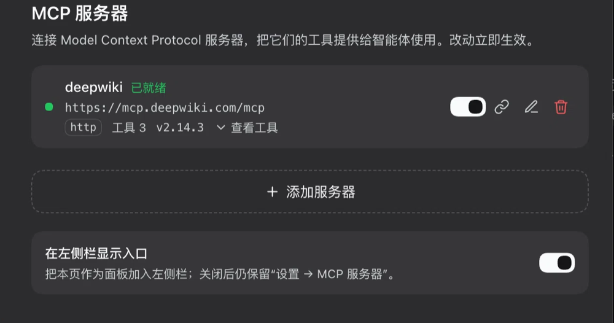
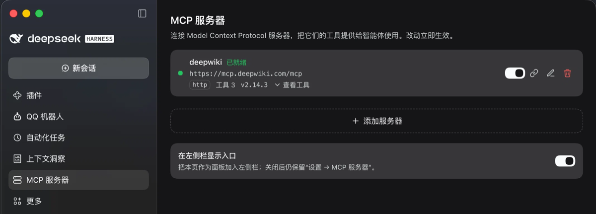

# dsh-mcp-manager


给 [DeepSeek Harness](https://github.com/deepseek-ai/deepseek-harness) 增加 MCP 服务器管理：
在界面里增删改查 **Model Context Protocol** 服务器，把它们的工具注册成模型可直接调用的
`mcp__<服务器名>__<工具名>`，不用手改 `cordis.patch.yml`，也不用重启。

[English](README.md) | 中文

## 功能

- **两个入口，同一个页面**：**设置 → MCP 服务器** 始终存在；可选的左侧栏入口用本插件自己的
  图标，打开的是同一个页面的独立面板。页面底部「在左侧栏显示入口」开关控制（默认开启）。
- **界面里完成全部操作**：添加、编辑、启用/停用、重连、删除。保存即连接；停用会结束子进程并
  撤掉该服务器的工具；重连重新握手并原子替换工具集。
- **两种传输**：stdio（命令、参数、环境变量、工作目录）与 Streamable HTTP（URL、请求头）。
- **实时状态**：已连接 / 连接中 / 失败（带服务器报错原文）、工具数、服务器版本、instructions、
  可展开的工具清单。
- **外部条目可见、可开关、不重复连接**：已经在 `@deepseek-ai/dsh-mcp-client` 独立条目里配置的
  服务器会列出来（入口 id + 实时工具数），可以在本页直接**启用/停用**（等同「设置 → 插件」里的
  开关），也能一键迁移。点「迁到此页」会**先停用原条目**再把配置复制成
  本页记录并连接，所以不会出现两条连接抢同一批工具名。
- **零依赖**：自带一个小型 MCP 客户端（stdio JSON-RPC + Streamable HTTP）、原子 JSON 存储和
  八条精确 Fetch 路由，无构建步骤。

## 截图

设置 → MCP 服务器：一台在线服务器的状态、端点、工具数与版本，内容末尾的虚线添加行，以及控制
第二个入口的「在左侧栏显示入口」开关。



同一个页面从左栏打开——左栏图标是本插件自己的，两处渲染完全一致。




## 安装

需要一个提供 Cordis Fetch 路由与插槽 API 的 Harness 构建（开发与验证基于 `0.2.1-rc.5`）。

### Web UI（桌面端或 `dsh web`）

1. 打开 **设置 → 插件 → 添加插件**；
2. 填 `@kuhufu/dsh-mcp-manager`，点 **安装**；
3. 在插件列表里确认 bundle 已**启用**——安装和启用是两步，装好但没启用的 bundle 不会加载任何东西。

从源码安装请改用下面的命令行：它会把目录作为 link 装进去，改动在重新加载后生效。

### `dsh` 命令行

```sh
# 安装到命令行 profile（web / tui / 你自己的 profile 名）；发布到 npm 后可用
dsh plugin --profile web add @kuhufu/dsh-mcp-manager

# 升级到已发布的最新版本
dsh plugin --profile web update @kuhufu/dsh-mcp-manager@latest

# 卸载
dsh plugin --profile web remove @kuhufu/dsh-mcp-manager
```

装完启动 UI（`dsh web`），如果 bundle 还没启用，到 **设置 → 插件** 里打开。从源码安装同理：

```sh
git clone https://github.com/kuhufu/dsh-mcp-manager.git
dsh plugin --profile web add ./dsh-mcp-manager   # 相对路径按 shell 当前目录解析
```

### 桌面端 profile

桌面应用独占 `desktop` 这个 profile：先打开一次应用让 profile 初始化，然后**完全退出**应用，再执行

```sh
dsh plugin --profile desktop add @kuhufu/dsh-mcp-manager
```

最后重新打开应用。应用运行期间跑插件命令可能和它的 profile 锁竞争。

> npm 上的 `dsh-mcp-manager` 属于另一个无关项目，所以本插件发布在 `@kuhufu` scope 下。
> 在它发布到 npm 之前，按上面的方式从 Git 检出安装。

## 使用

| 操作 | 说明 |
| --- | --- |
| 添加服务器 | 选传输方式填参数后保存；保存即连接，工具立刻出现 |
| 启用 / 停用 | 停用会结束子进程并移除该服务器的工具，配置保留 |
| 重连 | 重新握手并重建工具集（改完环境变量或服务器升级后用） |
| 编辑 | 改配置后自动重启该连接；名称变更会换工具命名空间 |
| 删除 | 断连 + 移除工具 + 删除记录（行内二次确认） |
| 在左侧栏显示入口 | 安装/移除左侧栏入口；设置里的页面不受影响 |
| 外部条目开关 | 直接启用/停用某条 `dsh-mcp-client` 配置，效果等同「设置 → 插件」；同名记录已被本页管理时标为「已在本页管理」并锁住开关，避免两边抢工具名 |

**工具命名**：`mcp__<服务器名>__<原始工具名>`，非法字符替换为 `_`（如 `mix.content` →
`mcp__mix_content`）。MCP 返回 `isError` 时调用失败并带出服务器文本；重连或重启会原子替换整批工具。

**传输**：

- `stdio`：`command` + `args` + `env`（+ 可选 `cwd`），例如
  `command: npx`、`args: -y @modelcontextprotocol/server-filesystem /tmp`。
- `http`（Streamable HTTP）：`url` + 可选 `headers`（如 `Authorization: Bearer …`）。

## 数据与安全

- 配置存放在 `$DSH_HOME/storages/mcp-manager.json`（`$DSH_HOME` 默认 `~/.dsh`），原子写入，
  读取时校验；文件损坏或来自旧版本时退化为空列表 + 默认偏好，不会让页面挂掉。
- 环境变量和请求头以**明文**保存。若被接管的 `dsh-mcp-client` 条目用了
  `!!js process.env.X`，复制过来的是求值后的真实值。
- MCP 服务器是以你的用户身份启动的普通进程，本插件不额外加沙箱；只添加可信的服务器。

## 结构

| 部分 | 文件 | 职责 |
| --- | --- | --- |
| Host | `index.js` + `host/mcp.js`、`host/store.js`、`host/routes.js` | 记录、MCP 连接、工具注册与 Fetch 路由 |
| Client | `client.js` | 一个 React 页面，注册进 `settings.section`；可选再注册 `sidebar.panellist` + `main` |

页面通信全部走 Harness Fetch 桥上的精确 `POST` 路由（相对路径 `api/mcp-manager.*`，由浏览器
会话鉴权，`cache-control: no-store`）：

| 路由 | 用途 |
| --- | --- |
| `list` | 本页管理的服务器 + 只读 `external` 行 + `ui` |
| `save` / `remove` / `toggle` / `reconnect` | 服务器增删改与连接控制 |
| `takeover` | 停用一条 `dsh-mcp-client` 条目并重新建成本页记录 |
| `toggle-external` | 启用/停用某条 `dsh-mcp-client` 条目 |
| `ui` | `railEntry` 偏好 |

请求/响应结构、校验规则和工具桥接契约见 [CONTRACT.md](CONTRACT.md)。

## 开发

纯 ESM，无构建步骤、无依赖，Node 22+。

```bash
node --check index.js && node --check client.js
node test/mcp.smoke.mjs        # 29 项：传输、存储、路由、整插件生命周期
node test/external.smoke.mjs   # 54 项：外部条目、一键接管、ui 偏好
node test/takeover-race.smoke.mjs   # 8 项：接管时旧连接的异步释放竞态
```

两套测试都不依赖框架：驱动真实模块跑真实 stdio/HTTP 传输与假 MCP 服务器，并断言所有子进程
都被回收。

## 常见问题

**`连接失败 — tool "mcp__X__y" is already registered`**
说明同一批工具名已被另一条 MCP 连接占用，通常是同名 `serverName` 的
`@deepseek-ai/dsh-mcp-client` 条目。不要手动再加一份：在下方只读的「通过 dsh-mcp-client
配置的服务器」里点 **迁到此页**——它会先停用原条目、等旧工具释放完再连接，两条连接不会抢名字。
如果本页已经有同名记录（比如卡在报错状态的那条），迁移会**原地替换**它并保留 id，所以直接再点
一次「迁到此页」就能修好。如果冲突的服务器不在这个列表里，先到「设置 → 插件」找到并停用它的
条目，再回来点重连。

**装完看不到页面**——安装和启用是两步：先在「设置 → 插件」里启用 bundle，然后刷新窗口。

**设置导航里是齿轮图标**——宿主按 section id 映射导航图标，第三方设置页只能是回退的齿轮图标；
本插件自己的图标在左侧栏入口上，由页面底部的开关控制。

## 已知边界

- 不支持 MCP 图片/音频结果的持久化，非文本块以文字说明呈现。
- 不支持 MCP prompts 模板与 resources 订阅（与官方 `dsh-mcp-client` 的限制一致）。
- 服务端工具名跨服务器撞名（如服务器 `a__b`+工具 `c` 与服务器 `a`+工具 `b__c`）会使该服务器
  注册失败并显示错误态，而不是自动改名。
- 设置导航里第三方页面的图标由宿主固定为齿轮，无法自定义；本插件自己的图标体现在左侧栏入口上。

## License

[MIT](LICENSE)
